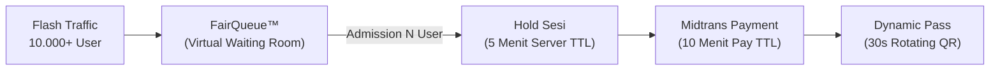
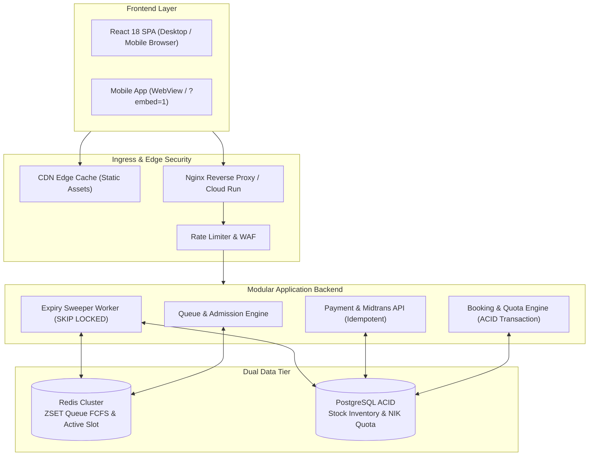

# Deck Presentasi & Live Demo: Booket
### PT DJS (Deploy Jumat Sore) — Solusi Tender Rusuh Booking Ticket
**Karakter Dokumen:** Dual Pitch (Client Solution Showcase & Deep Technical Assessment Defense)

---

```carousel
### Slide 1: Company Profile & Executive Summary
PT DJS (Deploy Jumat Sore) mempersembahkan Booket: Solusi War Tiket Konser Skala Masif yang Resilien, Adil, dan Anti-Overselling.
<!-- slide -->
### Slide 2: Pemahaman Masalah Klien (The "War Tiket" Crisis)
Analisis mendalam 4 titik kegagalan sistem tiket konvensional: Spike Crash, Bot Scalper, Overselling, dan Sesi "PHP".
<!-- slide -->
### Slide 3: Pilar Solusi PT DJS
Virtual Waiting Room (FairQueue™), Server-Authoritative Two-Tier TTL, dan Transaksi Database Atomik.
<!-- slide -->
### Slide 4: Arsitektur Sistem Skala Enterprise
Desain High-Concurrency: Edge CDN/Gateway, Redis ZSET FCFS Queue, PostgreSQL ACID Data Store, & Expiry Sweeper.
<!-- slide -->
### Slide 5: Deep Dive: Virtual Waiting Room & FairQueue™
Mekanisme antrean FCFS O(log N), admission control adaptif, polling dinamis, serta Self-Healing Fallback.
<!-- slide -->
### Slide 6: Deep Dive: Concurrency & Atomic Hold Tiket
Pencegahan oversell via SQL conditional decrement, batas 3 tiket/order dengan 1 NIK = 1 Tiket Peserta (UU PDP compliant), dan hold 5 menit.
<!-- slide -->
### Slide 7: Deep Dive: Integrasi Midtrans & Idempotensi
Alur pembayaran multi-kanal (VA, QRIS, CC) dengan callback terverifikasi, reusable WebView (?embed=1), dan proteksi double charge.
<!-- slide -->
### Slide 8: Deep Dive: E-Ticket Notched Pass & Anti-Fraud Lapangan
Notched Ticket Pass dengan Dynamic Barcode / QR Code berotasi periodik, mencegah manipulasi tangkapan layar oleh calo.
<!-- slide -->
### Slide 9: Standar Engineering & GitLab CI/CD 6-Stage Pipeline
91 test files, 666 automated tests dengan coverage >=80%, SonarQube quality gate, secret scan, dan deploy Cloud Run (asia-southeast2).
<!-- slide -->
### Slide 10: Skenario Live Demo Interaktif (Demo Runbook)
Panduan mendemokan aplikasi secara langsung: Happy Path, Guard NIK Unik, Pemulihan Antrean di Beranda, dan Pembayaran Midtrans.
<!-- slide -->
### Slide 11: Nilai Tambah Bisnis & Ekosistem Mitra
Integrasi aplikasi mobile mitra, program loyalitas poin, proteksi reputasi brand, dan kedaulatan data UU PDP.
<!-- slide -->
### Slide 12: Penutup & Tanya Jawab Teknis (Technical Defense)
Komitmen delivery PT DJS, kesiapan produksi, dan sesi tanya jawab teknis dengan panel assessor.
```

---

## Slide-by-Slide: Naskah Presentasi, Arsitektur, & Speaker Notes

---

### Slide 1: Cover & Pengenalan Identitas

#### Konten Visual Slide
- **Header**: **PT DJS (Deploy Jumat Sore)** — **Booket**
- **Judul Produk**: **Booket — High-Concurrency Concert Ticketing & Fair Virtual Queue Platform**
- **Sub-judul**: *Proposal Teknis & Demonstrasi Sistem — Tender Rusuh Booking Ticket*
- **Disajikan Oleh**: Tim Engineering & Solusi PT DJS
- **Tagline**: *"Menjamin Keadilan, Meniadakan Overselling, Menjaga Reputasi Brand di Puncak Flash Crowd."*

#### Poin Kunci
- PT DJS hadir bukan hanya membawa prototipe visual, melainkan **arsitektur siap produksi** yang dirancang khusus untuk mengatasi traffic spikes ekstrem saat flash war tiket konser musik.
- Dual compliance: Memenuhi kebutuhan bisnis promotor/klien sekaligus standar rekayasa perangkat lunak level enterprise.

> **Speaker Notes (Presenter PT DJS):**
> *"Selamat pagi/siang bapak dan ibu panel penilai dan manajemen klien. Kami dari **PT DJS (Deploy Jumat Sore)** merasa terhormat dapat mempresentasikan solusi kami, **Booket**, untuk menjawab kebutuhan strategis **Tender Rusuh Booking Ticket**.*
>
> *Nama kami mungkin terdengar santai—Deploy Jumat Sore—tetapi filosofi engineering kami sangat serius: sistem kami dibangun begitu kokoh, teruji, dan stabil, sehingga bahkan bila dideploy di saat paling menantang, tim tetap tenang tanpa insiden. Hari ini kami akan membedah tidak hanya antarmuka aplikasi, melainkan arsitektur teknis di baliknya."*

---

### Slide 2: Pemahaman Masalah Klien (The "War Tiket" Dilemma)

#### Konten Visual Slide
- 4 Masalah Utama Sistem Tiket Konvensional:
  1. **Traffic Spikes Ekstrem**: 20.000+ request per detik menghantam database di detik ke-0 (HTTP 500 / 504 Gateway Timeout).
  2. **Serangan Bot & Calo**: Script otomatis dan pembukaan banyak tab untuk memborong tiket melebihi batas kuota.
  3. **Overselling (Tiket Terjual Minus)**: Race condition pada database menyebabkan tiket terjual melebihi kapasitas venue, memicu tuntutan hukum dan rusuh di venue.
  4. **Sindrom "PHP" (Sesi Hilang di Tengah Jalan)**: Pengguna sudah menunggu berjam-jam, namun sesi putus saat klik checkout atau terlambatnya notifikasi transfer bank.

#### Dampak Bisnis bagi Klien
- Kerusakan reputasi brand penyelenggara di media sosial akibat keluhan massal warganet.
- Beban komplain dan refund manual yang memakan biaya operasional tinggi.

> **Speaker Notes:**
> *"Bapak dan ibu, kita semua memahami apa yang terjadi ketika tiket konser band besar dibuka. Masalahnya bukan sekadar kapasitas bandwidth, melainkan **ketiadaan manajemen antrean di hulu**. Ketika puluhan ribu transaksi serentak memukul database transaksional, sistem akan mengalami deadlock, overselling, dan memutus sesi pengguna secara sepihak.*
>
> *Di PT DJS, kami menetapkan prinsip: **Pembeli tiket tidak boleh di-PHP**. Sistem harus adil (FCFS), transparan, dan memiliki jaminan zero-overselling."*

---

### Slide 3: Pilar Solusi PT DJS

#### Konten Visual Slide
- 3 Pilar Solusi Utama:
  - **Pilar 1: Admission Control & FairQueue™**: Hot path transaksi dilindungi antrean virtual in-memory; hanya $N$ pengguna aktif yang diizinkan masuk ke ruang pemesanan.
  - **Pilar 2: Two-Tier Server-Authoritative TTL**: Sesi pemesanan terkunci 5 menit, disusul batas bayar 10 menit. Timer dihitung otoritatif dari jam server, kebal manipulasi jam lokal perangkat.
  - **Pilar 3: Atomic Conditional Reservation & Guard NIK**: Maksimal 3 tiket per order dengan aturan ketat `1 NIK = 1 Tiket Peserta` yang terenkripsi ramah UU PDP (HMAC-SHA256) dan bebas race condition.



> **Speaker Notes:**
> *"Untuk menyelesaikan masalah ini secara tuntas, Booket mengusung 3 pilar utama: Pertama, **Admission Control** yang menahan beban di gerbang luar, sehingga sistem transaksi inti selalu beroperasi di bawah kapasitas aman. Kedua, **Server-Authoritative TTL** dua tahap (5 menit isi form, 10 menit bayar). Dan ketiga, **Atomic Reservation** yang menjamin kuota maksimal 3 tiket per order dan 1 NIK per tiket peserta."*

---

### Slide 4: Arsitektur Sistem Skala Enterprise

#### Konten Visual Slide


#### Justifikasi Desain Teknikal
- **Separation of Concerns**: Read-path ekstrem (antrean) diserahkan ke Redis in-memory dengan kompleksitas $O(\log N)$. Write-path kritis (uang & stok) diserahkan ke PostgreSQL ACID.
- **Horizontal Scalability**: Seluruh service berjalan stateless di Google Cloud Run (`asia-southeast2`) untuk auto-scale instan saat jadwal war tiba.

> **Speaker Notes:**
> *"Dari kacamata arsitektur teknis, kami tidak mencampuradukkan beban antrean dengan beban database relasional. Antrean dikelola sepenuhnya menggunakan Redis Sorted Set berkecepatan mikrodetik. Database relasional PostgreSQL hanya menerima request dari pengguna yang telah memegang access token resmi."*

---

### Slide 5: Deep Dive: Virtual Waiting Room & Self-Healing Fallback

#### Konten Visual Slide
- **Sequential Monotonic ID**: Nomor antrean selalu berurutan (FCFS via `ZRANK`, tidak bisa disalip).
- **Adaptive Polling**: Refresh berkala + jitter ramah bandwidth seluler dan menghindarkan gateway dari *reconnection storm*.
- **Self-Healing Fallback (`waitingRoomFallback.ts`)**: Bila server mengembalikan payload 200 OK berformat legacy yang ditolak DTO `@booketid/core` (`INVALID_RESPONSE`), klien otomatis mengaktifkan fallback parser (`etaSeconds` & klasifikasi error permanen/transien) tanpa crash.
- **Session Recovery ("Antrean Anda")**: Jika pengguna kembali ke beranda atau membuka ulang tab, posisi antrean dipulihkan lewat kartu *Lanjutkan Antrean*.

> **Speaker Notes:**
> *"Bagi tim penilai teknis, perhatikan mekanisme waiting room kami. Selain memakai ZRANK Redis O(log n), di frontend kami membangun Self-Healing Fallback di `waitingRoomFallback.ts`. Jika ada ketidakcocokan format payload 200 OK dari backend legacy, UI tetap menyajikan nomor antrean dan ETA tanpa layar putih atau error."*

---

### Slide 6: Deep Dive: Concurrency, Stok Atomik & Guard NIK

#### Konten Visual Slide
```sql
BEGIN;
  -- 1. Kunci Kuota NIK (Maks 3 tiket per order, 1 NIK = 1 Tiket Peserta)
  INSERT INTO nik_quotas (event_id, nik_hash, reserved_qty)
  VALUES (:event_id, :nik_hash, :qty)
  ON CONFLICT (event_id, nik_hash) DO NOTHING;

  -- 2. Kurangi Stok Kategori (Mencegah Oversell)
  UPDATE ticket_categories
  SET available = available - :qty
  WHERE id = :category_id AND available >= :qty;
COMMIT;
```

- Validasi domain murni di `src/domain/rules.ts` (`MAX_TICKETS_PER_ORDER = 3`, `NIK_LENGTH = 16`, `hasDuplicateParticipantNiks()`).
- Kepatuhan UU PDP: NIK disimpan dalam bentuk hash satu arah (`HMAC-SHA256`) dan dimasking pada tampilan publik.

> **Speaker Notes:**
> *"Kami tidak mengandalkan validasi di sisi browser semata. Pengurangan stok dijalankan dengan conditional SQL atomic update di PostgreSQL. Bila stok tersisa 1 tapi ada 2 transaksi bersamaan, transaksi kedua otomatis di-rollback. Di aplikasi web sendiri, kami menerapkan batas 3 tiket per order dan aturan tegas 1 NIK unik untuk setiap tiket peserta."*

---

### Slide 7: Deep Dive: Midtrans Payment, Reusable WebView & Idempotensi

#### Konten Visual Slide
- **Midtrans Gateway & Callback Resmi**: Mendukung Virtual Account (BCA, Mandiri, BRI, BNI), QRIS, dan Kartu Kredit, dengan callback route `/payment/success`, `/payment/status`, `/payment/failed`.
- **Order Snapshot Persistence (`orderSnapshot.ts`)**: Data peserta dan ringkasan biaya tetap aman saat browser redirect ke halaman pembayaran eksternal Midtrans.
- **Reusable WebView Design (`?embed=1`)**: Mendukung penyematan langsung di WebView aplikasi mobile mitra dengan menyembunyikan header/navigasi web.
- **Idempotency & Expiry Sweeper**: Menggunakan `Idempotency-Key` UUID serta worker `FOR UPDATE SKIP LOCKED` untuk melepas hold kedaluwarsa secara aman.

> **Speaker Notes:**
> *"Untuk pembayaran, Booket terintegrasi penuh dengan Midtrans dan menyimpan snapshot order secara aman selama proses redirect. Halaman pembayaran juga dirancang agar mudah disematkan di dalam WebView aplikasi mobile klien dengan kunci idempotensi pencegah tagihan ganda."*

---

### Slide 8: Deep Dive: E-Ticket Notched Pass & Anti-Fraud Lapangan

#### Konten Visual Slide
- **Notched Pass Design**: Tampilan pass digital berlekuk (`PaymentSuccessView.tsx`) dengan detail peserta terverifikasi, kategori tiket, gate, dan kode booking.
- **Dynamic Rotating Barcode / QR Code**: Barcode diperbarui secara berkala agar tangkapan layar (screenshot) tidak bisa dijual ulang ke banyak pembeli oleh calo.
- **Halaman `/tiket`**: Daftar seluruh booking aktif dan QR masing-masing pemegang tiket.

> **Speaker Notes:**
> *"Setelah pembayaran Midtrans terverifikasi, pembeli langsung memperoleh Pass Konser berlekuk yang dilengkapi Dynamic QR Code. Langkah ini mencegah penyalahgunaan screenshot tiket oleh calo di pintu masuk venue."*

---

### Slide 9: Standar Engineering & GitLab CI/CD Pipeline

#### Konten Visual Slide
- **666 Automated Unit Tests** di **91 test files** (`vitest run --coverage`) dengan ambang batas coverage $\ge 80\%$.
- **Zero TypeScript Errors**: Strict compilation check (`tsc -b --noEmit`).
- **6 Stages `.gitlab-ci.yml`**:
  1. `verify-code-quality` (`npm audit` + Gitleaks secret scan)
  2. `case-coverage` (`vitest --coverage` + JUnit + LCOV)
  3. `code-rank` (SonarQube Quality Gate)
  4. `build` (`tsc -b && vite build`)
  5. `package` (Docker multi-stage Nginx Alpine ke GCP Artifact Registry Jakarta)
  6. `deploy` (Google Cloud Run `asia-southeast2`)

> **Speaker Notes:**
> *"Kualitas kode kami dijaga oleh 666 unit tests di 91 file serta 6 tahap pipeline otomatis di GitLab CI/CD, mulai dari secret scan Gitleaks, SonarQube, hingga containerisasi otomatis ke Google Cloud Run Jakarta."*

---

### Slide 10: Skenario Live Demo Interaktif (Demo Runbook)

| Skenario | Langkah Demonstrasi | Poin Penekanan |
|---|---|---|
| **1. Happy Path & Waiting Room** | Login Keycloak → Pilih konser → Masuk `/waiting-room` → Pantau countdown & sync → Auto-redirect ke `/checkout`. | Transisi mulus tanpa reload halaman & dukungan fallback payload. |
| **2. Guard Kuota 3 & NIK Unik** | Tambah hingga 3 tiket (terkunci otomatis) → Isi NIK sama pada 2 slot peserta → Sistem menolak duplikasi (`1 NIK = 1 Tiket`). | Kepatuhan aturan bisnis & validasi murni di `rules.ts`. |
| **3. Session Persistence (Anti-PHP)** | Kembali ke Beranda saat masih antre → Kartu **Antrean Anda** muncul → Klik lanjutkan. | Pemulihan sesi otomatis agar pengguna tidak kehilangan antrean. |
| **4. Midtrans & Pass Konser** | Submit checkout → Selesaikan pembayaran Midtrans → Tinjau Pass Berlekuk & daftar tiket di `/tiket`. | Pengalaman end-to-end hingga tiket siap dipakai di venue. |

---

### Slide 11: Nilai Strategis bagi Ekosistem Bisnis Klien

- **Integrasi Aplikasi Mobile Mitra**: Mode WebView embedded memudahkan penyematan fitur war tiket konser ke dalam aplikasi mobile mitra untuk mendorong transaksi in-app.
- **Program Loyalitas & Priority Access**: Mendukung integrasi penukaran poin loyalitas atau membership eksklusif untuk diskon tiket maupun antrean prioritas.
- **Proteksi Reputasi Brand**: Menghindari krisis sentimen negatif akibat server down atau dugaan kecurangan calo.
- **Kedaulatan Infrastruktur**: Autentikasi Keycloak OIDC standar industri dan hosting terisolasi di region Jakarta (`asia-southeast2`).

---

### Slide 12: Penutup & Tanya Jawab Teknis (Technical Defense)

#### Lembar Antisipasi Pertanyaan Teknis Penguji
1. **Redis crash saat ribuan user antre?** — Redis Cluster/Sentinel + replikasi multi-AZ & AOF persistence; circuit breaker di API gateway mencegah error 500 mentah ke klien.
2. **Manipulasi jam di perangkat pembeli?** — Menggunakan UTC timestamp server-authoritative (`expiryEpochSeconds`) + validasi mutlak `now() <= expires_at` di backend (`HTTP 410`).
3. **Kenapa PostgreSQL conditional update untuk stok?** — Karena stok bernilai finansial & kapasitas fisik (ACID); Waiting Room sudah membatasi jumlah user aktif sehingga PostgreSQL bekerja ringan tanpa risiko data drift.
4. **Pembeli sudah bayar di menit 9:59 tapi webhook telat?** — Expiry sweeper melakukan inquiry status ke Midtrans/gateway terlebih dahulu sebelum menandai pesanan kadaluwarsa (*Anti-PHP Policy*).
