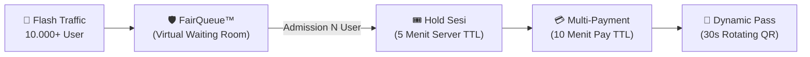
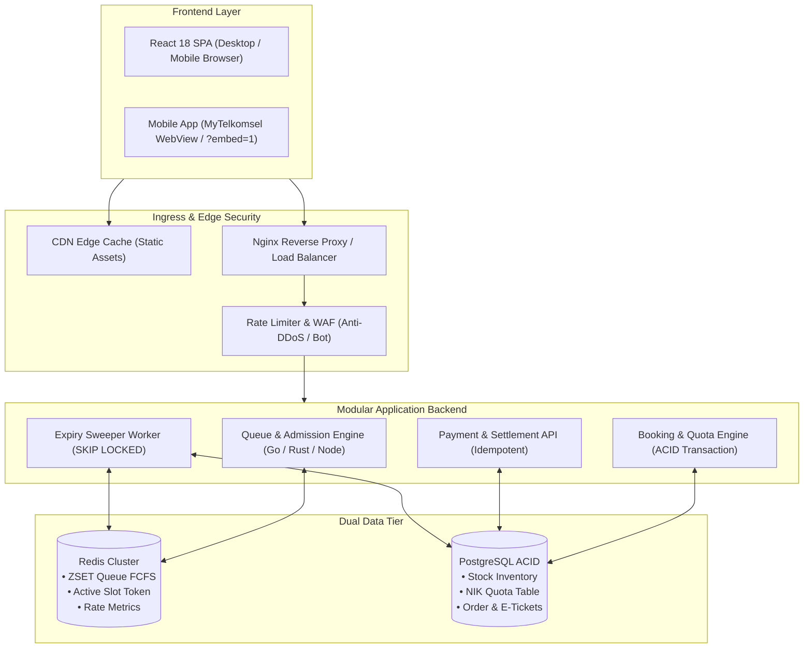
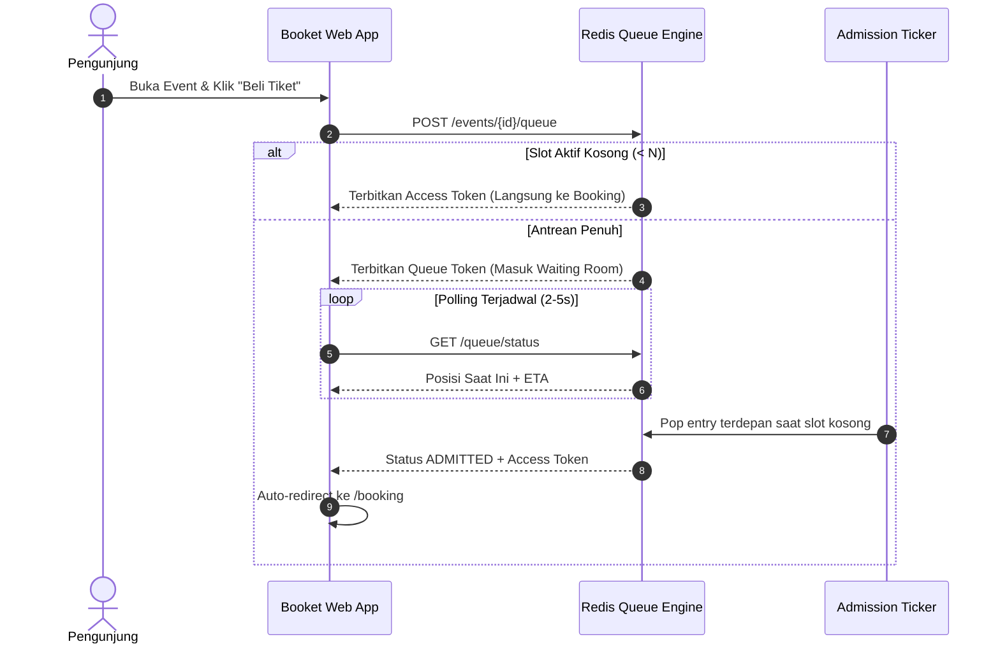
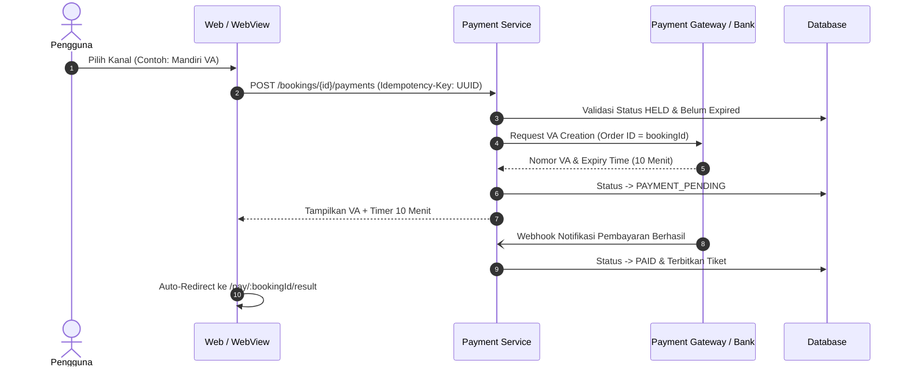
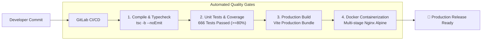

# 🚀 Deck Presentasi & Live Demo: Booket.id
### PT DJS (Deploy Jumat Sore) — Solusi Tender Rusuh Booking Ticket Telkomsel
**Karakter Dokumen:** Dual Pitch (Client Solution Showcase & Deep Technical Assessment Defense)

---

```carousel
### Slide 1: Company Profile & Executive Summary
PT DJS (Deploy Jumat Sore) mempersembahkan Booket.id: Solusi War Tiket Konser Skala Masif yang Resilien, Adil, dan Anti-Overselling.
<!-- slide -->
### Slide 2: Pemahaman Masalah Klien (The "War Tiket" Crisis)
Analisis mendalam 4 titik kegagalan sistem tiket konvensional: Spike Crash, Bot Scalper, Overselling, dan Sesi "PHP".
<!-- slide -->
### Slide 3: Pilar Solusi PT DJS untuk Telkomsel
Virtual Waiting Room (FairQueue™), Server-Authoritative Two-Tier TTL, dan Transaksi Database Atomik.
<!-- slide -->
### Slide 4: Arsitektur Sistem Skala Enterprise
Desain High-Concurrency: Edge CDN/Gateway, Redis ZSET FCFS Queue, PostgreSQL ACID Data Store, & Expiry Sweeper.
<!-- slide -->
### Slide 5: Deep Dive: Virtual Waiting Room & FairQueue™
Mekanisme antrean FCFS O(log N), admission control adaptif, polling dinamis, dan persistensi sesi lintas tab/perangkat.
<!-- slide -->
### Slide 6: Deep Dive: Concurrency & Atomic Hold Tiket
Pencegahan oversell via SQL conditional decrement, pembatasan 3 tiket per NIK (UU PDP compliant), dan hold 5 menit.
<!-- slide -->
### Slide 7: Deep Dive: Reusable Payment WebView & Idempotensi
Satu antarmuka pembayaran untuk Web & Mobile WebView (?embed=1), multi-kanal (VA, QRIS, CC), dan proteksi double charge.
<!-- slide -->
### Slide 8: Deep Dive: E-Ticket Anti-Fraud Lapangan
Dynamic Barcode & QR Code rotasi 30 detik pada digital ticket pass, mencegah manipulasi tangkapan layar (screenshot) oleh calo.
<!-- slide -->
### Slide 9: Standar Engineering & Software Quality Assurance
91 test suites, 666 automated tests dengan coverage >=80% per file, zero TypeScript error, dan pipeline otomatis GitLab CI/CD.
<!-- slide -->
### Slide 10: Skenario Live Demo Interaktif (Demo Runbook)
Panduan mendemokan aplikasi secara langsung: Happy Path, Kuota NIK Guard, dan Simulasi Sesi Antrean.
<!-- slide -->
### Slide 11: Nilai Tambah Bisnis bagi Telkomsel
Sinergi ekosistem Telkomsel: integrasi MyTelkomsel, proteksi reputasi brand, dan kepuasan pelanggan kelas satu.
<!-- slide -->
### Slide 12: Penutup & Tanya Jawab Teknis (Technical Defense)
Komitmen delivery PT DJS, kesiapan produksi, dan sesi tanya jawab teknis dengan panel assessor.
```

---

## 📑 Slide-by-Slide: Naskah Presentasi, Arsitektur, & Speaker Notes

---

### Slide 1: Cover & Pengenalan Identitas

#### 🎯 Konten Visual Slide
- **Header**: **PT DJS (Deploy Jumat Sore)** × **Telkomsel**
- **Judul Produk**: **Booket.id — High-Concurrency Concert Ticketing & Fair Virtual Queue Platform**
- **Sub-judul**: *Proposal Teknis & Demonstrasi Sistem — Tender Rusuh Booking Ticket*
- **Disajikan Oleh**: Tim Engineering & Solusi PT DJS
- **Tagline**: *"Menjamin Keadilan, Meniadakan Overselling, Menjaga Reputasi Brand di Puncak Flash Crowd."*

#### 📌 Poin Kunci
- PT DJS hadir bukan hanya membawa prototipe visual, melainkan **arsitektur siap produksi** yang dirancang khusus untuk mengatasi traffic spikes ekstrem saat flash war tiket konser musik.
- Dual compliance: Memenuhi kebutuhan bisnis promotor/Telkomsel sekaligus standar rekayasa perangkat lunak level enterprise.

> 🗣️ **Speaker Notes (Presenter PT DJS):**
> *"Selamat pagi/siang bapak dan ibu tim penilai dan manajemen Telkomsel. Kami dari **PT DJS (Deploy Jumat Sore)** merasa terhormat dapat mempresentasikan solusi kami, **Booket.id**, untuk menjawab kebutuhan strategis **Tender Rusuh Booking Ticket**.*
>
> *Nama kami mungkin jenaka—Deploy Jumat Sore—tetapi filosofi engineering kami sangat serius: sistem kami dibangun begitu kokoh, teruji, dan stabil, sehingga bahkan bila dideploy di saat paling menantang, sistem tetap bekerja tanpa kegagalan. Hari ini kami akan membedah tidak hanya keunggulan antarmuka aplikasi, melainkan arsitektur teknis yang menjamin sistem tidak akan crash di puncak flash war."*

---

### Slide 2: Pemahaman Masalah Klien (The "War Tiket" Dilemma)

#### 🎯 Konten Visual Slide
- 4 Masalah Utama Sistem Tiket Konvensional:
  1. 💥 **Traffic Spikes Ekstrem**: 20.000+ request per detik menghantam database di detik ke-0 (HTTP 500 / 504 Gateway Timeout).
  2. 🤖 **Serangan Bot & Calo**: Script otomatis memborong tiket, memanipulasi kuota identitas, dan merugikan fans sejati.
  3. 📉 **Overselling (Tiket Terjual Minus)**: Race condition pada database menyebabkan tiket terjual melebihi kapasitas venue, memicu tuntutan hukum dan rusuh di venue.
  4. 💔 **Sindrom "PHP" (Sesi Hilang di Tengah Jalan)**: Pengguna sudah menunggu berjam-jam, namun mental saat klik checkout atau saat melakukan transfer bank.

#### 📌 Dampak Bisnis bagi Telkomsel
- Kerusakan reputasi brand Telkomsel di media sosial akibat keluhan massal warganet.
- Beban komplain dan refund manual yang memakan biaya operasional tinggi.

> 🗣️ **Speaker Notes:**
> *"Bapak dan ibu, kita semua memahami apa yang terjadi ketika tiket konser band besar dibuka: Coldplay, Bruno Mars, atau festival musik nasional. Masalahnya bukan sekadar kapasitas bandwidth, melainkan **ketiadaan manajemen antrean di hulu**. Ketika puluhan ribu transaksi serentak memukul database transaksional, sistem akan mengalami deadlock, overselling, dan memutus sesi pengguna secara sepihak.*
>
> *Di PT DJS, kami menetapkan prinsip: **Konsumen Telkomsel tidak boleh di-PHP**. Sistem harus adil (FCFS), transparan, dan memiliki jaminan zero-overselling."*

---

### Slide 3: Pilar Solusi PT DJS untuk Telkomsel

#### 🎯 Konten Visual Slide
- 3 Pilar Solusi Utama:
  - **Pilar 1: Admission Control & FairQueue™**: Hot path transaksi dilindungi antrean virtual in-memory; hanya $N$ pengguna aktif yang diizinkan masuk ke ruang pemesanan.
  - **Pilar 2: Two-Tier Server-Authoritative TTL**: Sesi pemesanan terkunci 5 menit, disusul batas bayar 10 menit. Timer dihitung otoritatif dari jam server, kebal manipulasi jam lokal perangkat.
  - **Pilar 3: Atomic Conditional Reservation & Guard NIK**: Maksimal 3 tiket per NIK terverifikasi dengan enkripsi ramah UU PDP (HMAC SHA-256) dan reservasi DB bebas race condition.



> 🗣️ **Speaker Notes:**
> *"Untuk menyelesaikan masalah ini secara tuntas, Booket.id mengusung 3 pilar utama: Pertama, **Admission Control** yang menahan beban di gerbang luar, sehingga sistem transaksi inti selalu beroperasi di bawah kapasitas aman. Kedua, **Server-Authoritative TTL** dua tahap (5 menit isi form, 10 menit bayar) yang tersinkronisasi presisi. Dan ketiga, **Atomic Reservation** yang menjamin kuota 3 tiket per NIK tidak pernah bisa dibobol oleh race condition multi-tab."*

---

### Slide 4: Arsitektur Sistem Skala Enterprise

#### 🎯 Konten Visual Slide
- Diagram arsitektur modular berdaya tahan tinggi:



#### 📌 Justifikasi Desain Teknikal
- **Separation of Concerns**: Read-path ekstrem (antrean) diserahkan ke Redis in-memory dengan kompleksitas $O(\log N)$. Write-path kritis (uang & stok) diserahkan ke PostgreSQL ACID.
- **Horizontal Scalability**: Seluruh application backend bersifat *stateless*, siap di-scale horizontal di Kubernetes/GKE secara instan saat jadwal war tiba.

> 🗣️ **Speaker Notes:**
> *"Dari kacamata arsitektur teknis, kami tidak mencampuradukkan beban antrean dengan beban database relasional. Antrean dikelola sepenuhnya menggunakan Redis Sorted Set berkecepatan mikrodetik. Database relasional PostgreSQL hanya menerima request dari pengguna yang telah memegang tiket akses resmi. Dengan demikian, database kita tidak akan pernah mengalami kelebihan beban (CPU 100%) meskipun puluhan ribu orang antre di luar."*

---

### Slide 5: Deep Dive: Virtual Waiting Room & FairQueue™

#### 🎯 Konten Visual Slide
- Mekanisme Kerja Antrean FCFS:
  - **Sequential Monotonic ID**: Nomor antrean selalu berurutan (tidak ada yang bisa melompati antrean).
  - **Real-Time Queue Metrics**: Menampilkan nomor antrean live, estimasi waktu tunggu (ETA), dan status server.
  - **Adaptive Polling**: Interval refresh dinamis (2–5 detik + jitter) yang ramah bandwidth seluler dan tidak membebani server layaknya jutaan koneksi WebSocket yang drop.
  - **Session Recovery ("Antrean Anda")**: Jika pengguna tanpa sengaja menutup browser, koneksi putus, atau kembali ke beranda, posisi antrean tersimpan aman dan tombol *Lanjutkan Antrean* langsung muncul.



> 🗣️ **Speaker Notes:**
> *"Bagi tim penilai teknis, perhatikan mekanisme waiting room kami. Algoritma antrean menggunakan `ZRANK` di Redis, memberikan kompleksitas waktu O(log n). Saat giliran tiba, Admission Ticker secara atomik mempromosikan pengguna dan mengalirkan mereka langsung ke halaman formulir. Dan yang terpenting: jika browser pengguna mati atau jaringan seluler beralih ke BTS lain, token antrean di local storage & cookie HttpOnly akan memulihkan posisi mereka secara instan."*

---

### Slide 6: Deep Dive: Concurrency & Atomic Hold Tiket

#### 🎯 Konten Visual Slide
- Aturan Bisnis & Proteksi Database:
  - **Batas Maksimal 3 Tiket per NIK**: Tidak dapat dibobol oleh pemesanan ganda di tab berbeda.
  - **Atomic SQL Execution**: Penguncian stok dan pengecekan kuota dieksekusi dalam satu transaksi atomik.
  - **Kepatuhan UU PDP**: NIK tidak disimpan mentah (*plain-text*), melainkan menggunakan hash satu arah (`HMAC-SHA256`) untuk validasi kuota dan masking `3171********1234` untuk tampilan publik.

```sql
-- EKSEKUSI DATABASE ATOMIK TANPA RACE CONDITION:
BEGIN;
  -- 1. Kunci Kuota NIK (Maks 3 Tiket per NIK per Event)
  INSERT INTO nik_quotas (event_id, nik_hash, reserved_qty)
  VALUES (:event_id, :nik_hash, :qty)
  ON CONFLICT (event_id, nik_hash)
  DO UPDATE SET reserved_qty = nik_quotas.reserved_qty + EXCLUDED.reserved_qty
  WHERE nik_quotas.reserved_qty + EXCLUDED.reserved_qty <= 3;
  -- Jika gagal constraint -> Rollback, kembalikan 422 QUOTA_EXCEEDED

  -- 2. Kurangi Stok Kategori (Mencegah Oversell)
  UPDATE ticket_categories
  SET available = available - :qty
  WHERE id = :category_id AND available >= :qty;
  -- Jika rowcount = 0 -> Rollback, kembalikan 409 OUT_OF_STOCK

  -- 3. Terbitkan Booking Status HELD (5 Menit TTL)
  INSERT INTO bookings (id, status, payment_expires_at, ...) VALUES (...);
COMMIT;
```

> 🗣️ **Speaker Notes:**
> *"Inilah pembuktian teknis anti-overselling kami. Kami tidak mengandalkan validasi di sisi aplikasi atau JavaScript yang rentan dibypass. Kami menggunakan conditional SQL atomic update. Jika tiket tersisa 1 dan ada 2 transaksi masuk di milidetik yang sama, transaksi kedua otomatis gagal dan di-rollback tanpa menimbulkan stok negatif. Begitu pula untuk NIK: sistem mengunci kuota 3 tiket secara atomik di level database."*

---

### Slide 7: Deep Dive: Reusable Payment WebView & Idempotensi

#### 🎯 Konten Visual Slide
- Keunggulan Integrasi Pembayaran:
  - **Multi-Kanal Resmi**: Virtual Account (BCA, Mandiri, BRI, BNI), QRIS Dinamis 0% Fee, dan Kartu Kredit.
  - **Reusable WebView Design**: Halaman `/pay/:bookingId` dapat berjalan mandiri di web desktop maupun tertanam di aplikasi mobile seperti MyTelkomsel (`?embed=1`) dengan menyembunyikan header/footer web.
  - **Idempotency Guarantee**: Setiap transaksi pembayaran membawa header `Idempotency-Key` (UUID). Menekan tombol berulang kali tidak akan pernah menghasilkan tagihan ganda.
  - **Expiry Sweeper (Background Worker)**: Menjalankan query `SELECT ... FOR UPDATE SKIP LOCKED` tiap 5 detik untuk mengembalikan kuota tiket yang kadaluwarsa ke antrean secara aman tanpa mengunci tabel.



> 🗣️ **Speaker Notes:**
> *"Di sisi pembayaran, kami memahami kebutuhan integrasi dengan ekosistem Telkomsel. Halaman pembayaran Booket dirancang responsif dan fleksibel: dapat dibuka langsung di browser maupun disematkan di dalam WebView aplikasi MyTelkomsel dengan parameter embed. Seluruh transaksi dilengkapi kunci idempotensi, sehingga jika koneksi seluler tidak stabil dan pengguna menekan tombol bayar berulang kali, bank hanya menerima satu pesanan valid."*

---

### Slide 8: Deep Dive: E-Ticket Anti-Fraud Lapangan

#### 🎯 Konten Visual Slide
- Fitur E-Ticket Pass Digital:
  - **Notched Pass Design**: Tampilan tiket modern berlekuk dengan detail kategori, gate, baris kursi, dan nama pemesan.
  - **Rotating QR Code**: QR Code dinamis yang berganti payload kriptografis tiap 30 detik pada perangkat aktif.
  - **Anti-Screenshot & Anti-Calo**: Calo tidak dapat menjual hasil tangkapan layar (screenshot) ke banyak korban karena barcode kadaluwarsa dalam 30 detik.
  - **Offline-Ready Gate Scanner Validation**: Gate scanner di venue dapat memverifikasi keaslian tiket secara instan.

> 🗣️ **Speaker Notes:**
> *"Banyak promotor konser gagal mengendalikan calo di pintu masuk venue. Booket.id memecahkan masalah ini dengan Dynamic Rotating QR Code. Barcode tiket berotasi secara kriptografis tiap 30 detik. Tangkapan layar yang dijual calo di media sosial tidak akan bisa digunakan saat pemindaian di gate venue. Ini melindungi reputasi acara dan memastikan hanya pemilik sah yang dapat masuk."*

---

### Slide 9: Standar Engineering & Software Quality Assurance

#### 🎯 Konten Visual Slide
- Metrik Kualitas Rekayasa Perangkat Lunak:
  - 🧪 **91 Test Suites, 666+ Automated Unit Tests** (Vitest + React Testing Library).
  - 📊 **Cakupan Pengujian >= 80% Coverage** untuk setiap modul dan file fungsionalitas kritis (Branches, Lines, Functions, Statements).
  - 🛡️ **Zero TypeScript Error**: Pemeriksaan ketat tipe data (`tsc -b --noEmit`) tanpa kompromi `any`.
  - 🔄 **GitLab CI/CD Automated Pipeline**: Pipeline otomatis mencakup tahapan `compile-file`, `test:coverage`, `build-web` (Vite 13s), dan pembuatan Docker image siap pakai.



> 🗣️ **Speaker Notes:**
> *"Sebagai bukti keseriusan teknis PT DJS, aplikasi ini tidak hanya berfungsi di permukaan, tetapi didukung fondasi testing yang sangat matang. Kami memiliki 666 skenario unit test otomatis yang mencakup seluruh skenario normal, fallback, error network, hingga simulasi batas kuota. Tidak ada satu pun baris kode yang dilepas ke produksi tanpa melewati gerbang CI/CD otomatis kami."*

---

### Slide 10: Skenario Live Demo Interaktif (Demo Runbook)

#### 🎯 Panduan Langkah Demi Langkah Live Demo ke Klien

| Skenario | Langkah Demonstrasi | Poin yang Ditekankan ke Klien/Assessor |
|---|---|---|
| **Skenario 1: Happy Path & Waiting Room** | 1. Buka Beranda Booket.id.<br/>2. Pilih konser *Deploy Jumat Sore Live 2025*.<br/>3. Klik "Beli Tiket" → Masuk Waiting Room.<br/>4. Tunjukkan nomor antrean live, estimasi waktu, dan status koneksi.<br/>5. Tunggu giliran tiba → Auto-redirect ke `/booking`. | Tunjukkan betapa mulusnya transisi dari antrean ke checkout tanpa reload halaman. |
| **Skenario 2: Formulir Checkout & Kuota NIK** | 1. Tunjukkan countdown timer 5 menit di banner atas.<br/>2. Pilih kategori tiket (Regular/VIP).<br/>3. Masukkan NIK.<br/>4. Coba tambahkan lebih dari 3 tiket → Tombol terkunci otomatis.<br/>5. Coba masukkan NIK duplikat pada formulir peserta → Validasi mendeteksi duplikasi instan. | Buktikan kepatuhan terhadap aturan bisnis (maks 3 tiket/NIK) dan UX yang intuitif. |
| **Skenario 3: Session Persistence & Resiliensi** | 1. Saat berada di antrean atau booking, coba buka tab baru atau kembali ke Beranda (`/`).<br/>2. Tunjukkan kartu **"Lanjutkan Antrean"** yang muncul di Beranda.<br/>3. Klik "Lanjutkan" → Kembali ke posisi antrean tanpa kehilangan nomor urut. | Buktikan bahwa pengguna tidak akan kehilangan sesi (anti-PHP) saat jaringan terputus atau tab tertutup. |
| **Skenario 4: Pembayaran & E-Ticket Dinamis** | 1. Lanjut ke pembayaran → Tunjukkan pilihan Mandiri VA / BCA / QRIS.<br/>2. Tunjukkan countdown bayar 10 menit dan nomor VA.<br/>3. Selesaikan simulasi bayar → Masuk ke `/result`.<br/>4. Tunjukkan tiket digital berlekuk dan QR code yang berkedip/berotasi. | Berikan kepuasan visual terhadap hasil akhir tiket digital yang siap dipakai di venue. |

> 🗣️ **Speaker Notes:**
> *"Sekarang mari kita buktikan secara langsung. Saya akan memandu Anda melalui 4 skenario live demo: mulai dari pengalaman pengguna masuk antrean, pembuktian validasi batas kuota NIK, ketahanan sesi saat berpindah tab, hingga penerbitan dynamic e-ticket. Mari kita lihat layar demo bersama..."*

---

### Slide 11: Nilai Strategis bagi Ekosistem Telkomsel

#### 🎯 Konten Visual Slide
- Integrasi & Sinergi Bisnis:
  - 📱 **Integrasi MyTelkomsel**: Reusable WebView memungkinkan fitur war tiket konser menjadi nilai tambah di dalam aplikasi MyTelkomsel (layanan lifestyle & entertainment).
  - 💳 **Monetisasi & Loyalitas**: Potensi integrasi Telkomsel Poin untuk diskon tiket, serta pembayaran via IndiHome Pay / LinkAja / Telkomsel Redi.
  - 🛡️ **Proteksi Reputasi Brand**: Menghilangkan komplain viral di X (Twitter) atau Instagram akibat server ticketing down atau tuduhan orang dalam / calo.
  - 📊 **Insight Data Pengguna**: Dashboard analitik demografi penonton dan pola pembelian tiket untuk kampanye pemasaran Telkomsel berikutnya.

> 🗣️ **Speaker Notes:**
> *"Mengapa Booket.id adalah pilihan terbaik untuk Telkomsel? Karena solusi ini tidak hanya menyelesaikan persoalan teknis server, melainkan memperkuat ekosistem digital Telkomsel. Melalui arsitektur WebView kami, fitur war tiket konser ini dapat langsung di-embed ke dalam aplikasi MyTelkomsel, membuka peluang penukaran Telkomsel Poin, meningkatkan Monthly Active Users (MAU), dan mengukuhkan citra Telkomsel sebagai pemimpin teknologi terdepan di Indonesia."*

---

### Slide 12: Penutup & Tanya Jawab Teknis (Technical Defense)

#### 🎯 Ringkasan Penutup
- **Kesiapan Penuh**: Kode telah rampung, lulus uji coba 666 skenario test, dan siap diintegrasikan.
- **Komitmen PT DJS**: Kami siap mendukung deployment, load testing bersama tim Telkomsel, hingga pendampingan on-site saat hari-H konser.

---

### 🛡️ Lembar Antisipasi Pertanyaan Teknis Penguji (Q&A Defense Sheet)

#### ❓ Pertanyaan 1: *"Bagaimana jika server Redis antrean mengalami crash saat ribuan orang sedang antre?"*
> **Jawaban Teknis:**
> *"Redis kami konfigurasikan dengan Redis Sentinel / Redis Cluster dengan persistensi AOF (Append-Only File) dan replikasi multi-node. Jika master node failover, replica otomatis mengambil alih dalam hitungan milidetik tanpa kehilangan posisi antrean. Bila skenario terburuk koneksi Redis terputus total, aplikasi klien memiliki circuit breaker terpasang: antarmuka menampilkan pesan ramah 'Antrean sedang dipadatkan, mohon tunggu sebentar' dan melakukan auto-retry adaptif tanpa melempar error 500 mentah ke pengguna."*

#### ❓ Pertanyaan 2: *"Bagaimana Anda menjamin waktu 5 menit booking dan 10 menit bayar tidak dimanipulasi pengguna dengan memajukan jam di laptop/HP mereka?"*
> **Jawaban Teknis:**
> *"Sistem kami menggunakan arsitektur **Server-Authoritative TTL**. Server menghitung sisa waktu berdasarkan timestamp UTC server yang disimpan di database/Redis (`expires_at`), bukan dari durasi lokal klien. Klien hanya menerima `expires_at` dan menyinkronkan selisih jamnya via header HTTP `Date`. Jika pengguna memanipulasi jam lokal, saat request submit dikirim, server akan memvalidasi ulang: `if (now() > booking.expires_at)` maka transaksi langsung ditolak dengan kode 410 Gone / Session Expired."*

#### ❓ Pertanyaan 3: *"Mengapa memilih PostgreSQL dengan conditional update daripada counter in-memory Redis untuk pengurangan stok?"*
> **Jawaban Teknis:**
> *"Karena stok tiket berkaitan langsung dengan kepatuhan finansial dan kapasitas fisik venue (ACID). Redis sangat cepat tetapi rentan data drift jika terjadi restart sebelum sinkronisasi. Karena Waiting Room kami sudah berhasil membatasi jumlah pengguna aktif hanya sebanyak $N$ orang (misalnya 100–500 user aktif bersamaan), database PostgreSQL kami tidak akan kewalahan menangani 500 user aktif. Transaksi conditional update di PostgreSQL memberikan konsistensi mutlak tanpa risiko overselling sama sekali."*

#### ❓ Pertanyaan 4: *"Bagaimana penanganan jika user sudah transfer uang di menit ke-9.59, tetapi webhook bank baru sampai di menit ke-10.05 saat booking sudah kedaluwarsa?"*
> **Jawaban Teknis:**
> *"Ini adalah kasus klasik yang kami sebut 'Anti-PHP Policy'. Expiry Sweeper kami tidak langsung membatalkan pesanan yang statusnya `PAYMENT_PENDING` tanpa memverifikasi ke Payment Gateway. Sweeper akan memanggil API status gateway terlebih dahulu. Jika gateway menyatakan dana sudah settled sebelum batas waktu, sistem tetap memvalidasi tiket sebagai `PAID`. Jika pembayaran memang baru masuk setelah tiket terlanjur dialokasikan ke orang lain, sistem secara otomatis mengeksekusi trigger outbox auto-refund dan mengirimkan email notifikasi transparan ke pelanggan."*

---

> 🎯 **Pernyataan Penutup Presenter:**
> *"Terima kasih atas waktu dan perhatian bapak/ibu tim penilai Telkomsel. Kami dari PT DJS (Deploy Jumat Sore) siap menjawab seluruh pertanyaan teknis dan mendemokan sistem ini secara langsung."*
