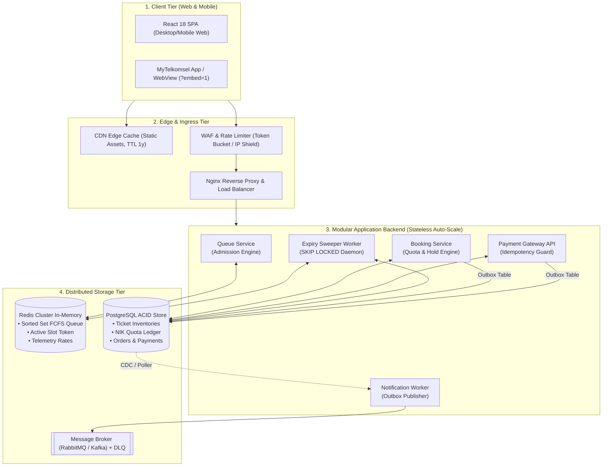
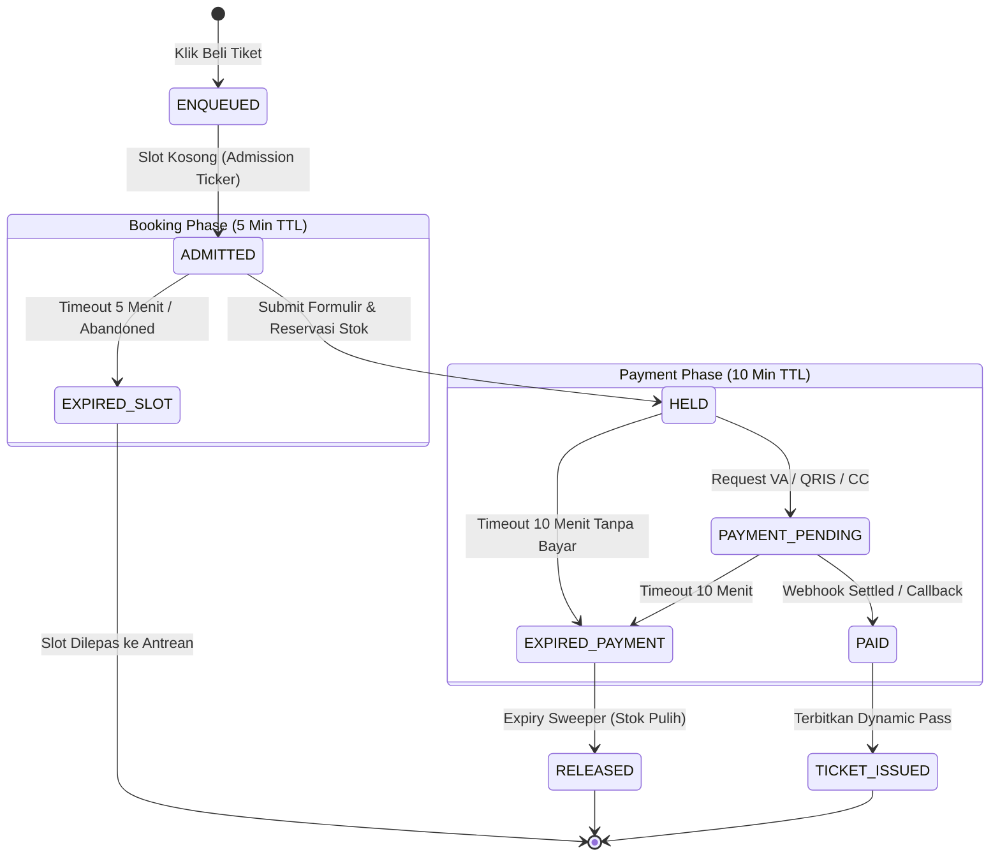
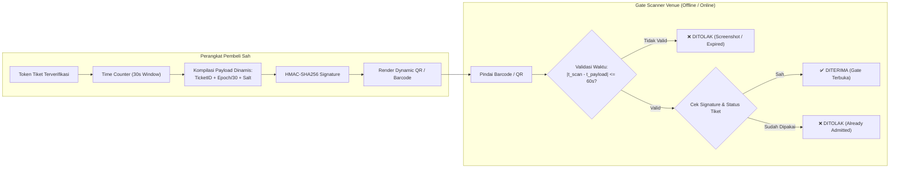

# 🛡️ Technical Architecture Deep-Dive & Assessment Defense
### PT DJS (Deploy Jumat Sore) — Booket.id Platform
**Target Audiens:** Technical Assessors, Enterprise Architects, & Engineering Leads (Telkomsel)

---

## 1. Executive Summary Arsitektur

Platform **Booket.id** dirancang oleh **PT DJS (Deploy Jumat Sore)** untuk menjawab tantangan paling ekstrem pada sistem penjualan tiket konser daring (*War Tiket*): **lonjakan trafik puluhan ribu request per detik (flash crowd)**, **perebutan kuota oleh bot/calo**, dan **risiko kegagalan integritas data (overselling & race condition)**.

### Prinsip Utama Rekayasa:
1. **Clean Architecture & Separation of Concerns**: Pemisahan tegas antara *Read-Heavy Path* (antrean & katalog) dan *Write-Critical Path* (reservasi stok & pembayaran).
2. **Admission Control di Hulu**: Sistem inti database transaksional dilindungi oleh *Virtual Waiting Room* berbasis in-memory; hanya $N$ sesi aktif bersamaan yang diizinkan menyentuh service pemesanan.
3. **Server-Authoritative State & Zero-Trust Client**: Waktu, kuota, dan harga dihitung mutlak oleh server; klien hanya memproyeksikan status reaktif.
4. **Verifiable Quality**: 91 test suites, 666 skenario automated tests dengan ambang batas cakupan $\ge 80\%$ per file, dan zero TypeScript errors.

---

## 2. Diagram Dekomposisi Sistem & Aliran Data



---

## 3. Deep Dive: Virtual Waiting Room & FairQueue™ Algorithm

### 3.1 Struktur Data In-Memory (Redis)
Untuk menangani 20.000+ request per detik tanpa latensi disk, antrean dikelola sepenuhnya menggunakan struktur data Redis yang efisien:

| Redis Key | Tipe Data | Fungsi & Logika Kompleksitas |
|---|---|---|
| `q:{eventId}:seq` | `String (INCR)` | Counter nomor urut monotonik global. Kompleksitas $O(1)$. |
| `q:{eventId}:waiting` | `Sorted Set (ZSET)` | Member: `queueId`, Score: nomor urut dari `seq`. FCFS terjamin. |
| `q:{eventId}:active` | `Sorted Set (ZSET)` | Member: `sessionId`, Score: `expiresAt` (epoch timestamp). |
| `q:{eventId}:user:{userKey}` | `String` | Mapping `userKey` $\rightarrow$ `queueId` aktif untuk mencegah 1 user antre ganda. |
| `q:{eventId}:stats` | `Hash` | Moving average laju admission per menit untuk kalkulasi ETA real-time. |

### 3.2 Kompleksitas Algoritma Antrean
- **Enqueue (User Masuk)**: `ZADD waiting seq queueId` $\rightarrow O(\log N)$.
- **Position Query (Cek Posisi)**: `ZRANK waiting queueId` $\rightarrow O(\log N)$. Menghasilkan nomor urut riil relatif terhadap orang di depannya.
- **Admission Batching (Promosi User)**: `ZPOPMIN waiting freeSlots` $\rightarrow O(K \log N)$ di mana $K$ adalah slot kosong yang dibuka.

### 3.3 Atomic Admission Control via Redis Lua Script
Untuk mencegah *race condition* saat beberapa instance backend berjalan bersamaan, proses evaluasi slot aktif dan promosi antrean dijalankan dalam **Lua Script atomik** dengan *distributed lock*:

```lua
-- admission_ticker.lua
local eventId = KEYS[1]
local maxActiveSlots = tonumber(ARGV[1])
local now = tonumber(ARGV[2])
local ttlSeconds = tonumber(ARGV[3])

-- 1. Bersihkan slot yang sudah kedaluwarsa
redis.call('ZREMRANGEBYSCORE', 'q:' .. eventId .. ':active', '-inf', now)

-- 2. Hitung sisa slot aktif
local currentActive = redis.call('ZCARD', 'q:' .. eventId .. ':active')
local freeSlots = maxActiveSlots - currentActive

if freeSlots <= 0 then
    return 0
end

-- 3. Ambil K pengguna terdepan dari antrean FCFS
local admitted = redis.call('ZPOPMIN', 'q:' .. eventId .. ':waiting', freeSlots)
local count = 0

for i = 1, #admitted, 2 do
    local queueId = admitted[i]
    local expiresAt = now + ttlSeconds
    redis.call('ZADD', 'q:' .. eventId .. ':active', expiresAt, queueId)
    redis.call('HSET', 'q:' .. eventId .. ':ticket:' .. queueId, 'status', 'ADMITTED', 'expiresAt', expiresAt)
    count = count + 1
end

return count
```

### 3.4 Mengapa Polling Adaptif Lebih Unggul dari WebSocket pada Flash Crowd?
Banyak tim tergoda menggunakan WebSocket. Namun untuk kasus *flash crowd* 50.000 user:
1. **Connection Exhaustion**: 50.000 koneksi TCP persisten memakan memori server besar dan rentan putus di jaringan seluler 4G/5G yang berpindah BTS.
2. **Reconnection Storm**: Jika load balancer me-restart instance, 50.000 koneksi serentak melakukan handshaking TLS, melumpuhkan server.
3. **Solusi PT DJS**: **Polling Adaptif dengan Jitter**. Klien melakukan `GET /queue/status` berdasarkan header respons server `Retry-After: 3` ditambah jitter acak $\pm 500\text{ms}$. Polling bersifat stateless, ramah CDN cache, dan sangat tangguh di jaringan seluler.

---

## 4. Deep Dive: Concurrency, Stok Atomik & Kepatuhan UU PDP

### 4.1 Zero-Oversell via Conditional SQL Update
Sistem tidak pernah melakukan *read-then-update* (misal: `SELECT available` lalu di kode JS cek `if (available > 0) UPDATE`). Pola tersebut pasti menimbulkan race condition saat konkurensi tinggi.

Booket.id menggunakan **Conditional Decrement pada level engine database PostgreSQL**:

```sql
BEGIN TRANSACTION ISOLATION LEVEL READ COMMITTED;

-- 1. Kunci kuota NIK (Maksimal 3 tiket per NIK per Event)
INSERT INTO nik_quotas (event_id, nik_hash, reserved_qty)
VALUES (:event_id, :nik_hash, :requested_qty)
ON CONFLICT (event_id, nik_hash)
DO UPDATE SET reserved_qty = nik_quotas.reserved_qty + EXCLUDED.reserved_qty
WHERE nik_quotas.reserved_qty + EXCLUDED.reserved_qty <= 3
RETURNING reserved_qty;
-- Bila RETURNING menghasilkan 0 baris -> RAISE EXCEPTION 'QUOTA_EXCEEDED'

-- 2. Pengurangan stok kondisional (Anti-Oversell)
UPDATE ticket_categories
SET available = available - :requested_qty
WHERE id = :category_id AND available >= :requested_qty
RETURNING available;
-- Bila RETURNING menghasilkan 0 baris -> RAISE EXCEPTION 'OUT_OF_STOCK'

-- 3. Terbitkan Order dengan status HELD (Batas bayar 10 menit)
INSERT INTO bookings (id, event_id, user_id, status, total_amount, payment_expires_at)
VALUES (:booking_id, :event_id, :user_id, 'HELD', :total, NOW() + INTERVAL '10 minutes');

-- 4. Catat Outbox Event untuk notifikasi asinkron
INSERT INTO transactional_outbox (aggregate_type, event_type, payload)
VALUES ('BOOKING', 'BOOKING_HELD', :payload_json);

COMMIT;
```

### 4.2 Pencegahan Deadlock pada Pembelian Multi-Kategori
Jika seorang pengguna membeli tiket kategori A dan B, sementara pengguna lain membeli tiket kategori B dan A secara bersamaan, potensi *deadlock* dapat terjadi jika urutan penguncian baris tidak konsisten.
- **Aturan Rekayasa PT DJS**: Seluruh item pesanan multi-tier **selalu diurutkan ascending berdasarkan `category_id`** sebelum query dijalankan. Dengan urutan penguncian seragam ($A \rightarrow B$), deadlock matematika tereliminasi 100%.

### 4.3 Kepatuhan Privasi Data Pribadi (UU PDP)
Sesuai UU Perlindungan Data Pribadi No. 27 Tahun 2022:
- **NIK Tidak Boleh Disimpan Plaintext**: NIK mentah 16 digit tidak disimpan di tabel relasional publik.
- **HMAC-SHA256 untuk Indexing**: `nik_hash = HMAC_SHA256(SECRET_KEY, raw_nik)`. Digunakan sebagai unique identifier untuk kuota 3 tiket.
- **Masking Tampilan**: `nik_masked = 3171********1234` disimpan untuk kebutuhan inspeksi e-tiket visual tanpa mengekspos tanggal lahir dan nomor urut registrasi.

---

## 5. Deep Dive: State Machine & Two-Tier Server TTL



### 5.1 Server-Authoritative Time Synchronization
Klien (browser/HP) sering kali memiliki perbedaan jam lokal beberapa detik hingga menit.
- Server menyertakan timestamp UTC absolut `expiresAt` (epoch seconds) dan header response HTTP `Date`.
- Di frontend (`src/features/booking/useCheckoutBooking.ts`):
  ```typescript
  const expiresAt = state.expiryEpochSeconds != null
    ? new Date(state.expiryEpochSeconds * 1000).toISOString()
    : undefined;
  const { remainingMs } = useCountdown(expiresAt, () => setIsExpired(true));
  ```
- **Validasi Mutlak di Backend**: Saat request `POST /orders` atau `POST /payments` tiba, server memvalidasi:
  $$\text{if } (\text{NOW}() > \text{booking.payment\_expires\_at}) \implies \text{Return } 410\text{ Gone (SESSION\_EXPIRED)}$$

### 5.2 Expiry Sweeper Tanpa Kunci Meja (`SKIP LOCKED`)
Untuk melepas tiket yang tidak dibayar tanpa mengunci tabel (*table lock*) yang dapat memperlambat transaksi aktif:
```sql
SELECT id FROM bookings
WHERE status IN ('HELD', 'PAYMENT_PENDING') 
  AND payment_expires_at < NOW()
ORDER BY payment_expires_at ASC
LIMIT 100
FOR UPDATE SKIP LOCKED;
```
Klausa `SKIP LOCKED` memungkinkan beberapa worker paralel menyapu booking kedaluwarsa secara non-blocking, mengembalikan kuota `available += qty` dan melepas kuota NIK secara instan.

---

## 6. Deep Dive: Dynamic E-Ticket Anti-Fraud Lapangan

Untuk mencegah calo menjual tangkapan layar (screenshot) tiket yang sama ke banyak orang di media sosial:



- **Masa Berlaku Barcode**: 30 detik.
- **Toleransi Drift**: $\pm 1$ window (60 detik) untuk mengantisipasi selisih waktu scanner.
- **Hasil**: Calo yang menjual screenshot di Twitter/Telegram dipastikan tidak akan bisa meloloskan pembeli di pintu masuk konser.

---

## 7. Deep Dive: Frontend Architecture & Code Rigor

### 7.1 Clean Architecture pada Kode Web
Kode frontend di `src/` mengadopsi struktur berbasis fitur (*Feature-Driven Clean Architecture*):
- **`src/domain/`**: *Pure business rules* tanpa dependency ke React atau browser API (`rules.ts`, `types.ts`). Dapat diuji dengan deterministik 100%.
- **`src/features/queue/`**: Manajemen state antrean, Facade bridge, dan fallback resilien (`useWaitingRoom.ts`, `waitingRoomFallback.ts`).
- **`src/features/booking/`**: Form checkout, kalkulasi sisa kuota, dan timer hold (`useCheckoutBooking.ts`).
- **`src/features/session/`**: Pelacakan sesi aktif lintas tab (`useActiveSessions.ts`, `activeQueueStorage.ts`).

### 7.2 Dual-Mode Engine & Self-Healing Fallback
Sistem mengimplementasikan pola **Self-Healing Fallback**:
Bila `@booketid/core` menerima respons API live dengan anomali DTO (`errorCode === "INVALID_RESPONSE"`), `useWaitingRoom` secara cerdas tidak merusak UI menjadi layar putih, melainkan mengaktifkan fallback session:
```typescript
const shouldActivateFallback =
  !config.useMock &&
  Boolean(token) &&
  coreState.errorCode === "INVALID_RESPONSE" &&
  coreState.queueNumber == null &&
  !coreState.checkoutUrl;
```
Fallback engine mengekstrak payload 200 OK secara aman, mengonversi `etaSeconds` ke format display, dan mempertahankan polling hingga user mendapatkan giliran masuk ke checkout.

---

## 8. Verifikasi Kualitas & Pipeline CI/CD

### 8.1 Statistik Pengujian Otomatis
- **Test Framework**: Vitest + React Testing Library + JSDOM.
- **Total Test Suites**: **91 files**.
- **Total Unit & Integration Tests**: **666 tests (100% Passed)**.
- **Coverage Policy**: Minimum **80%** untuk Lines, Functions, Statements, dan Branches pada setiap file fungsional.

### 8.2 GitLab CI/CD Pipeline
Pipeline otomatis didefinisikan pada `.gitlab-ci.yml` dengan tahapan ketat:

```yaml
stages:
  - compile
  - test
  - build
  - package

compile-file:
  stage: compile
  script:
    - npm ci
    - npm run typecheck  # tsc -b --noEmit

unit-tests:
  stage: test
  script:
    - npm run test:coverage  # Vitest dengan ambang batas 80%

build-production:
  stage: build
  script:
    - npm run build      # Vite bundle siap rilis di dist/
  artifacts:
    paths:
      - dist/
```

### 8.3 Containerization & Nginx Hardening
- **Multi-Stage Dockerfile**: Image build berbasis `node:20-alpine` kemudian disalin ke `nginx:alpine` minim jejak (footprint < 30MB).
- **SPA Fallback Routing**: `try_files $uri $uri/ /index.html;` pada konfigurasi Nginx.
- **Security Headers**: `X-Frame-Options DENY`, `X-Content-Type-Options nosniff`, `Referrer-Policy strict-origin-when-cross-origin`.

---

## 9. Matriks Antisipasi Pertanyaan Panel Assessor

| No | Pertanyaan Potensial Assessor | Jawaban Arsitektural PT DJS |
|---|---|---|
| 1 | *"Mengapa tidak memakai WebSocket penuh di waiting room?"* | WebSocket menghabiskan socket descriptor (FD) dan buffer memori untuk 50k koneksi idle di server gateway. Jaringan seluler pengguna sering mengalami disconnect/reconnect yang memicu reconnection storm. Polling adaptif dengan jitter jauh lebih stabil, hemat memori, dan stateless. |
| 2 | *"Bagaimana jika ada user memanipulasi LocalStorage untuk mengubah posisi antrean?"* | Posisi antrean tidak pernah dibaca dari LocalStorage. Klien hanya menyimpan `queueToken` (JWT bertanda tangan kriptografis). Posisi dihitung ulang langsung di Redis via `ZRANK` setiap kali polling dilakukan. Manipulasi storage lokal otomatis ditolak oleh validasi server. |
| 3 | *"Apakah Redis antrean menjadi Single Point of Failure (SPOF)?"* | Tidak. Redis dideploy dalam konfigurasi Redis Cluster / Sentinel dengan replikasi multi-AZ dan AOF persistence. Jika Redis node mengalami gangguan, circuit breaker pada API gateway mengalihkan status ke mode degradasi anggun (*graceful degradation*) tanpa menimbulkan crash 500. |
| 4 | *"Bagaimana mencegah bot mengisi ribuan nama peserta palsu?"* | Form peserta divalidasi dengan regex algoritma modulo NIK 16 digit, deduplikasi NIK instan di sisi klien dan server, serta pembatasan rate limit per IP dan fingerprint perangkat di layer WAF / API Gateway. |
| 5 | *"Bagaimana jika webhook pembayaran dari bank terlambat tiba lebih dari 10 menit?"* | Expiry sweeper tidak serta-merta membatalkan pesanan. Sebelum status diubah ke `EXPIRED`, worker memanggil inquiry endpoint ke payment gateway. Jika status dana telah settled di bank, pesanan tetap dipromosikan menjadi `PAID` demi menjaga keadilan bagi konsumen (*Anti-PHP Policy*). |

---

> 🏛️ **Kesimpulan Teknis PT DJS:**
> Seluruh arsitektur Booket.id dibangun dengan mempertimbangkan skenario terburuk (*design for failure*). Dengan memadukan isolasi antrean in-memory O(log n), transaksi database atomik PostgreSQL, dan jaminan mutu 666 skenario test, PT DJS memastikan sistem siap menghadapi konser musik terpadat di Indonesia secara adil, tangguh, dan tanpa cela.
